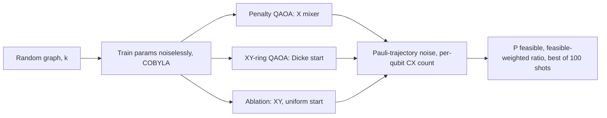
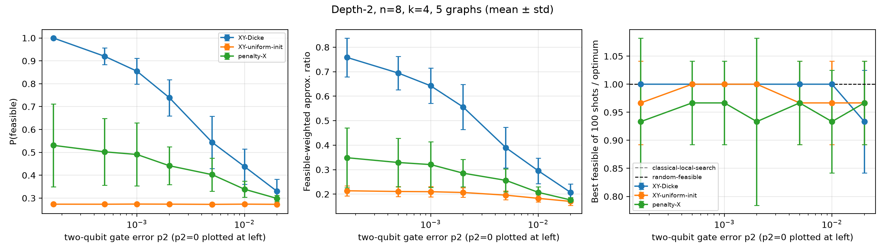
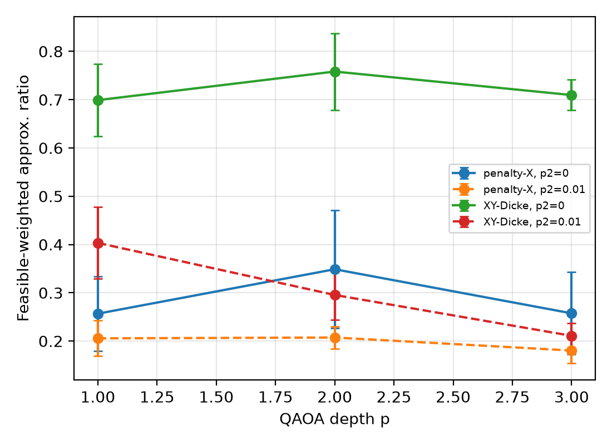

# XY-mixer vs penalty QAOA under gate noise

  

**Abstract.** Constrained QAOA mixers keep the state inside the feasible subspace but need far more two-qubit gates than penalty QAOA. This simulation study measures where that overhead cancels the benefit on densest-k-subgraph (n = 8, k = 4, 5 random graphs) under a CX-count-weighted depolarising noise model. At depth 2, XY-mixer QAOA with a Dicke start keeps a higher feasible-weighted approximation ratio than penalty QAOA at every tested noise level, but it falls below penalty QAOA's *noiseless* value between p2 = 5e-3 and 1e-2.

## Motivation and gap
Standard QAOA is poorly suited to constrained problems; restricting the mixer to the feasible subspace helps but enlarges the circuit and so reduces noise robustness (Wołk et al., 2027, doi:10.1016/j.ins.2026.124187). Realistic two-qubit errors are around 5e-3 on current neutral-atom hardware (Evered et al., 2023, doi:10.1038/s41586-023-06481-y). What is missing is a controlled measurement of the break-even noise rate. See [docs/RESEARCH_GAP.md](docs/RESEARCH_GAP.md) and [docs/METHOD.md](docs/METHOD.md).

## Method

Parameters are trained without noise and evaluated under noise. Noise per layer and qubit is a random Pauli with probability 1−(1−p2)^c, c being the CX gates on that qubit (penalty cost layer 14, XY cost layer 2·degree, XY ring mixer 8, X mixer 0). Dicke preparation is assumed ideal.

## Results (5 graphs, mean ± std, from `results/summary.csv`)
Feasible-weighted approximation ratio, depth 2:

| p2 | penalty-X | XY-Dicke |
|---|---|---|
| 0 | 0.349 ± 0.122 | 0.758 ± 0.079 |
| 5e-4 | 0.329 ± 0.099 | 0.694 ± 0.068 |
| 1e-3 | 0.321 ± 0.093 | 0.642 ± 0.072 |
| 2e-3 | 0.286 ± 0.056 | 0.556 ± 0.092 |
| 5e-3 | 0.256 ± 0.046 | 0.390 ± 0.083 |
| 1e-2 | 0.207 ± 0.023 | 0.295 ± 0.052 |
| 2e-2 | 0.176 ± 0.011 | 0.207 ± 0.035 |

P(feasible), depth 2: XY-Dicke 1.000 → 0.544 (p2 = 5e-3) → 0.330 (2e-2); penalty-X 0.531 → 0.403 → 0.299. XY with uniform start (ablation): 0.214 ± 0.021 at p2 = 0, i.e. no advantage; the Dicke start is what matters.




## Discussion
- H1 holds in the means: XY-Dicke is above penalty-X at every p2, and it drops below penalty-X's noiseless ratio (0.349) between p2 = 5e-3 (0.390) and 1e-2 (0.295). At the largest p2 the gap (0.207 vs 0.176) is within one XY std, so I do not claim a separation there.
- H2 holds: without the Dicke start the XY mixer is no better than penalty QAOA.
- Deeper is not better under noise: for XY-Dicke, p = 3 is worse than p = 2 already at p2 = 5e-4 (see `summary.csv`), and the noiseless p = 3 value is below p = 2 (0.710 vs 0.758), which I attribute to the limited optimiser budget (6 COBYLA restarts), not to physics.
- **Negative/caveat:** the best-of-100-shots metric is saturated (≈1.0) for every method, including random feasible sampling and classical local search, because the instance has only 70 feasible states. At this size it cannot discriminate methods; the ratio metrics do. No quantum advantage is claimed.

## Limitations
n = 8 only, one problem family, one noise model (uncorrelated depolarising, no readout or coherent error), ideal Dicke preparation, no transpilation to a device topology (CX counts are analytic), parameters not retrained under noise, only 5 graphs. The ring-XY Hamiltonian is applied as a single exact exponential (no Trotter error).

## Future work
Include Dicke-preparation cost, compare the gate-reduced hypercube mixer of the cited work, noise-aware retraining, larger n with tensor-network or sparse simulation, and device-calibrated noise on neutral-atom or superconducting hardware.

## Reproducibility
```
pip install -r requirements.txt
python -m pytest -q
python experiments/run_all.py --quick   # ~20 s
python experiments/run_all.py           # ~6 min (346 s here), Windows 11, CPU only
```

## Related work by the author
[qml-rl-maxcut](https://github.com/pradeepdegalaroyal/qml-rl-maxcut) (QAOA for Max-Cut) · [QEM-ZeroNoise-Extrapolation](https://github.com/pradeepdegalaroyal/QEM-ZeroNoise-Extrapolation)

## Structure
`src/xynoise/core.py` (simulator, models, baselines) · `experiments/run_all.py` · `tests/` · `results/` · `figures/` · `docs/`

## Citation
If you use this code, please cite it. GitHub's "Cite this repository" button reads [CITATION.cff](CITATION.cff).

```bibtex
@software{chenchupradeep2026xymixer,
  author  = {Chenchupradeep, Degala},
  title   = {XY-mixer vs penalty QAOA under gate noise},
  year    = {2026},
  version = {0.1.0},
  url     = {https://github.com/pradeepdegalaroyal/xy-mixer-vs-penalty-qaoa-noise-crossover},
  license = {MIT}
}
```

## License
Released under the MIT licence; see [LICENSE](LICENSE). Copyright (c) 2026 Degala Chenchupradeep.
